```mermaid
flowchart TD
    subgraph FromTelegram ["1. Chiều từ Telegram -> tmux (tg_bot_daemon.py)"]
        T1["Người dùng nhắn tin trên Telegram"] --> T2{"Có vuốt Reply vào
tin nhắn của cửa sổ B?"}
        T2 -- "Có" --> T3["Định tuyến riêng lượt này vào B
(Giữ nguyên mặc định là A)"]
        T2 -- "Không" --> T4["Định tuyến vào cửa sổ mặc định A"]
        T3 --> T5["Thoát copy-mode (tmux copy-mode -q)
Ghi ack_pending_<pane>.json & bơm phím"]
        T4 --> T5
        T5 --> T6{"Hook start của AI có xóa
ack_pending trong 5s?"}
        T6 -- "Có (< 5s)" --> T7["Hook start gửi ngay:
✅ OK — Đã nhận lệnh tại <pane>"]
        T6 -- "Không (Quá 5s)" --> T8["Daemon báo ⚠️ CHƯA NHẬN ĐƯỢC LỆNH
+ Chụp màn hình hiện tại + Nút Enter/Esc"]
    end

    subgraph StartTurn ["2. Bắt đầu lượt chạy (hook_notify.py start)"]
        A["Sự kiện PreInvocation / UserPromptSubmit"] --> B{"Có ack_pending_<pane>.json?"}
        B -- "Có (Từ Telegram)" --> C["Xóa ack_pending & Gửi Telegram:
✅ OK — Đã nhận lệnh tại <pane>"]
        B -- "Không (Gõ trên PC)" --> D{"Màn hình PC đang mở?"}
        D -- "Có" --> E["Tự động xóa away_mode.flag
(Chuyển về chế độ Here)"]
    end

    subgraph StopTurn ["3. Kết thúc lượt chạy (hook_notify.py stop)"]
        N["AI trả lời xong (Stop)"] --> O{"Lượt này từ Telegram
hoặc gõ kèm 'tg'?"}
        O -- "Có" --> P["Gửi: 💬 Trả lời truy vấn của bạn"]
        O -- "Không (Chạy ở chế độ Away)" --> Q{"Có nhãn thông báo
ở đầu câu?"}
        Q -- "Có + Cuối bài có câu hỏi" --> R["Gửi: 🙋‍♂️ Cần chốt phương án / nghiệp vụ
(Kèm nút Yes / No / Enter)"]
        Q -- "Có + Báo cáo kết quả" --> S["Gửi: 📋 Báo cáo tổng kết
(Không hiện nút Yes / No)"]
        Q -- "Không (Chạy >= 180s)" --> U["Gửi: ✅ Hoàn thành task"]
    end
```

# Tài liệu Luồng Nghiệp Vụ & Kế Hoạch Nâng Cấp (`ai-telegram` — `v1.6.0`)

Tài liệu này tổng hợp **luồng nghiệp vụ chuẩn (Core Business Flows)** đã được triển khai thực tế tới phiên bản **`v1.4.0`** và **lộ trình các hạng mục nâng cấp** cho hệ thống cầu nối điều khiển AI qua Telegram (`agy`, `claude`, `codex`).

---

## Phần 1: Luồng Nghiệp Vụ Chuẩn (Core Business Flows — `v1.4.0`)

### 1. Nguyên tắc cốt lõi
1. **Không giữ Hook chặn (Non-blocking Hooks)**: Mọi Hook (`start`, `ask`, `stop`) chỉ ghi nhận trạng thái và bắn thông báo HTTP sang Telegram rồi thoát ngay lập tức (`print("{}")`). Tuyệt đối không giữ vòng lặp chờ trong Hook để không bao giờ làm treo Terminal hay IDE.
2. **Xác nhận 2 lớp (Pre-execution Hook ACK)**:
   - Khi nhắn tin từ Telegram vào `tmux`, Daemon tự động thoát `copy-mode` (`tmux copy-mode -q`) rồi bơm lệnh và tạo cờ `ack_pending_<pane>.json`.
   - Ngay khi AI nhận được lệnh vào ô nhập (trước khi thực thi), **Hook `start`** (`PreInvocation` / `UserPromptSubmit`) xóa `ack_pending` và bắn bản tin xác nhận:
     `✅ OK — Đã nhận lệnh tại cửa sổ <pane> (<tool> • <folder>)`
   - Nếu sau **5 giây** mà Hook `start` không phản hồi (do gửi nhầm cửa sổ `tmux` hoặc con trỏ trong `tmux` không nằm ở ô nhập), Daemon lập tức gửi cảnh báo kèm ảnh chụp văn bản màn hình hiện tại và các nút cứu hộ (`[⏎ Gửi thêm Enter]`, `[⏹ Gửi phím Esc]`, `[📋 Đổi cửa sổ khác]`).
3. **Khóa cố định cửa sổ đang chọn (`A`) & Hỗ trợ vuốt `Reply` cho cửa sổ `B`**:
   - Khi bạn đã chọn cửa sổ **A**, `active_pane.txt` **luôn giữ cố định là A** (không bao giờ tự động nhảy sang **B** khi **B** bắn thông báo chen ngang).
   - Khi **B** báo tin về mà đang chọn **A** (`B != A`), cuối tin nhắn của **B** hiển thị dòng nhắc:
     `📌 Đang chọn mặc định: A — Hãy Reply tin nhắn này hoặc bấm 🎯 Chọn B nếu muốn gửi lệnh vào B.`
   - Nếu bạn bấm nút **`[💬 Trả lời]`** dưới tin nhắn của **B** (hoặc **vuốt trả lời `Reply`** trực tiếp vào tin nhắn của **B**), Daemon tự trích xuất tên cửa sổ `[B]` từ tiêu đề tin nhắn được Reply để gửi riêng câu trả lời đó vào **B** mà vẫn giữ **A** làm mặc định.
4. **Phân biệt rõ `📋 Báo cáo tổng kết` và `🙋‍♂️ Cần chốt phương án / nghiệp vụ`**:
   - Khi AI gắn nhãn thông báo ở đầu câu để báo cáo hoàn thành cột mốc (không có câu hỏi xin ý kiến ở cuối bài), hệ thống hiển thị **`📋 Báo cáo tổng kết (<thời_gian>s):`** và chỉ hiện nút `[🎯 Chọn cửa sổ]`, `[📸 Xem màn hình]` (không hiện nút `Yes / No`).
   - Chỉ khi AI thực sự đặt câu hỏi hoặc yêu cầu chọn phương án ở đoạn kết (`is_really_asking_decision`), hệ thống mới hiển thị **`🙋‍♂️ Cần chốt phương án / nghiệp vụ:`** kèm các nút `[✅ Yes (y)] [❌ No (n)] [⏎ Enter]`.

5. **Giám sát Hết Quota & Tự động báo khi Reset Quota (`check_tmux_quota_limits`)**:
   - Daemon quét định kỳ (mỗi 15s) vùng thanh trạng thái (status footer bên dưới vạch kẻ ô nhập `────────`) của các cửa sổ `tmux`.
   - Khi phát hiện biểu ngữ chạm trần (`⚠ Usage limit reached`, `You've hit your limit`, `exceeded your current quota`, `Quota exceeded`), hệ thống gửi ngay cảnh báo `🚨 CẢNH BÁO HẾT QUOTA / USAGE LIMIT!` kèm giờ reset (ví dụ `limit resets 11pm`) và lưu cờ `state/quota_alert_<pane>.json` để chỉ báo 1 lần duy nhất.
   - Ngay khi đến giờ reset và dòng cảnh báo biến mất (AI tự động chạy tiếp), hệ thống xóa cờ và bắn thông báo `🟢 ĐÃ RESET QUOTA & CHẠY LẠI!` về Telegram.

6. **Hiển thị trạng thái thời gian thực trong `/list` & Tự động dọn rác `state/` (`v1.4.0`)**:
   - Lệnh `/list` hiển thị trực tiếp trạng thái sống của từng cửa sổ `tmux`: `💤 Sẵn sàng`, `⚙️ Đang thực thi...`, `⏰ Đang hẹn giờ (Timer)`, `👀 Đang chạy Monitor`, hoặc `🚨 Hết quota (reset ...)`.
   - Tự động dọn dẹp các file `start_*.txt` / `prompt_tg_*.flag` mồ côi quá 12 giờ trong `state/`.

7. **Xử lý Bảng hỏi lựa chọn (`1/2/3`, `y/n`) & Hàng đợi thông minh (`Smart Queue` — `v1.4.0`)**:
   - **Tự động phát hiện bảng hỏi**: Khi màn hình `tmux` dừng ở hộp thoại chọn phương án (`Do you want to proceed?`, `(y/n)`, menu `❯ 1. / 2.`), Daemon tự chụp hộp thoại gửi về Telegram kèm bộ nút 1 chạm (`[1️⃣ Chọn 1]`, `[2️⃣ Chọn 2]`, `[3️⃣ Chọn 3]`, `[✅ Yes]`, `[❌ No]`, `[⏎ Enter]`, `[⏹ Esc]`).
   - **Gửi lựa chọn vào bảng hỏi**: Khi người dùng nhắn `1`, `2`, `3`, `y`, `n` lúc đang ở bảng hỏi, Daemon gửi thẳng phím lựa chọn và báo `✅ OK — Đã gửi lựa chọn vào bảng hỏi` (không chờ Hook `start`). Nếu người dùng nhắn câu văn bản dài lúc đang kẹt ở bảng hỏi, Daemon giữ câu đó vào Hàng đợi để không bị trôi chữ và nhắc chọn `1/2/y/n` trước.
   - **Khi gửi lệnh mới lúc AI đang bận thực thi (`⚙️ Đang thực thi...`)**: Daemon bơm trực tiếp vào hàng đợi tự nhiên (native queue) của `tmux`/AI, tăng bộ đếm `waiting_<pane>.flag`, và phản hồi (pong) ngay lập tức: `⏳ OK — Đã nhận lệnh tại [<pane>] (Lệnh này đang chờ xử lý do AI đang thực thi lệnh trước)`.

8. **Nhận diện thông minh khi chat trực tiếp qua `tmux` / SSH (`is_tmux_session_actively_watched` — `v1.4.0`)**:
   - Trên macOS, khi khóa màn hình vật lý của máy (`CGSSessionScreenIsLocked = True`) nhưng người dùng vẫn kết nối từ xa (SSH / iPad / laptop khác) để gõ trực tiếp trong `tmux`, hệ thống kiểm tra `#{client_activity}` của phiên `tmux` đó.
   - Nếu phiên `tmux` có thao tác bàn phím thực tế trong vòng 5 phút qua (hoặc câu lệnh vừa được gõ trực tiếp trên `tmux` chứ không phải từ Telegram), cửa sổ đó được nhận diện là **Here (`Đang ngồi máy`)** và tự xóa `away_mode.flag` — tuyệt đối **không** bắn ngược câu trả lời lên Telegram gây thừa thãi (trừ khi gõ kèm chữ `tg`).
   - Trong khi đó, các phiên `tmux` khác chạy ngầm không có người gõ (`client_activity >= 5 phút`) vẫn tự động báo kết quả về Telegram khi hoàn thành cột mốc!

   - **3 Cờ cấu hình chủ động trong `config.json`**:
     - `"notify_on_screen_lock": true` — Bật/tắt tự động gửi Telegram khi màn hình vật lý PC bị khóa.
     - `"notify_on_away": true` — Bật/tắt tự động gửi Telegram khi đang ở chế độ `/away`.
     - `"suppress_when_tmux_active": true` — Khi đang gõ trực tiếp trên phiên `tmux` (ví dụ SSH qua điện thoại), tự động tắt gửi trùng lên Telegram cho cửa sổ đang gõ.

---

### 2. Sơ đồ Luồng Nghiệp Vụ (`v1.4.0`)

---

## Phần 2: Trạng Thái Kế Hoạch Nâng Cấp (Upgrade Roadmap)

| Hạng mục | Nội dung nâng cấp | Phiên bản | Trạng thái |
| :--- | :--- | :---: | :---: |
| **Base** | Cầu nối 2 chiều `tmux` <-> Telegram ổn định, không dùng Hook chặn | `v1.0.0` | ✅ Đã hoàn thành |
| **P1** | Tách biệt định danh `tmux` (`TMUX_PANE`) và Terminal ngoài `tmux` (`term:<folder>`) | `v1.1.0` | ✅ Đã hoàn thành |
| **P2** | Nút bấm thông minh theo ngữ cảnh (`ask` hiện `Yes/No`, `stop` ẩn `Yes/No`) | `v1.1.0` | ✅ Đã hoàn thành |
| **P3** | Chia nhỏ tin nhắn dài thông minh theo dòng (giữ trọn phần đầu & phần kết luận cuối) | `v1.1.0` | ✅ Đã hoàn thành |
| **ACK** | Xác nhận 2 lớp từ Hook `start` (`✅ OK — Đã nhận lệnh`) + Cảnh báo 5s khi lệch con trỏ | `v1.2.0` | ✅ Đã hoàn thành |
| **Routing & Report** | Khóa cố định cửa sổ `A` + Hỗ trợ vuốt `Reply` vào cửa sổ `B` + Tách `📋 Báo cáo tổng kết` khỏi `🙋‍♂️ Cần chốt phương án` | `v1.4.0` | ✅ Đã hoàn thành |
| **Quota Monitor** | Phát hiện `Usage limit reached` trên `tmux` + Báo ngay khi hết Quota & khi Reset Quota chạy lại | `v1.4.0` | ✅ Đã hoàn thành |
| **Interactive Prompt & Smart Queue** | Tự động bắt bảng hỏi (`1/2/3`, `y/n`), Hàng đợi thông minh khi AI đang bận (`queue_<pane>.json`), Trạng thái sống trong `/list` & Dọn rác `state/` | `v1.4.0` | ✅ Đã hoàn thành |
| **Clean Screen Output** | Bộ lọc `clean_tmux_screen` rút gọn vạch kẻ 200 ký tự, khoảng trắng thừa status bar & rác TUI khi chụp `/screen` | `v1.5.0` | ✅ Đã hoàn thành |
| **Zero-Drop Reliability** | Fix `PreInvocation` multi-step mất cờ `waiting`, luôn gửi khi có `[TG_NOTIFY]`, gộp `PLANNER_RESPONSE` cùng lượt, và giữ `followup:120s` khi `fullyIdle=False` | `v1.6.0` | ✅ Đã hoàn thành |
| **P4** | *(Tùy chọn)* Module AppleScript độc lập cho Desktop GUI (`ChatGPT.app`, `Claude.app`) | Tương lai | ⏸ Chưa cần thiết (ưu tiên dùng `tmux`) |
