# Tài liệu Luồng Nghiệp Vụ & Kế Hoạch Nâng Cấp (`ai-telegram` — `v1.3.0`)

Tài liệu này tổng hợp **luồng nghiệp vụ chuẩn (Core Business Flows)** đã được triển khai thực tế tới phiên bản **`v1.3.0`** và **lộ trình các hạng mục nâng cấp** cho hệ thống cầu nối điều khiển AI qua Telegram (`agy`, `claude`, `codex`).

---

## Phần 1: Luồng Nghiệp Vụ Chuẩn (Core Business Flows — `v1.3.0`)

### 1. Nguyên tắc cốt lõi
1. **Không giữ Hook chặn (Non-blocking Hooks)**: Mọi Hook (`start`, `ask`, `stop`) chỉ ghi nhận trạng thái và bắn thông báo HTTP sang Telegram rồi thoát ngay lập tức (`print("{}")`). Tuyệt đối không giữ vòng lặp chờ trong Hook để không bao giờ làm treo Terminal hay IDE.
2. **Xác nhận 2 lớp (Pre-execution Hook ACK)**:
   - Khi nhắn tin từ Telegram vào `tmux`, Daemon tự động thoát `copy-mode` (`tmux copy-mode -q`) rồi bơm lệnh và tạo cờ `ack_pending_<pane>.json`.
   - Ngay khi AI nhận được lệnh vào ô nhập (trước khi thực thi), **Hook `start`** (`PreInvocation` / `UserPromptSubmit`) xóa `ack_pending` và bắn bản tin xác nhận:
     `✅ OK — Đã nhận lệnh tại cửa sổ <pane> (<tool> • <folder>)`
   - Nếu sau **5 giây** mà Hook `start` không phản hồi (do gửi nhầm cửa sổ `tmux` hoặc con trỏ trong `tmux` không nằm ở ô nhập), Daemon lập tức gửi cảnh báo kèm ảnh chụp văn bản màn hình hiện tại và các nút cứu hộ (`[⏎ Gửi thêm Enter]`, `[⏹ Gửi phím Esc]`, `[📋 Đổi cửa sổ khác]`).
3. **Khóa cố định cửa sổ đang chọn (`A`) & Hỗ trợ vuốt `Reply` cho cửa sổ `B`**:
   - Khi bạn đã chọn cửa sổ **A**, `active_pane.txt` **luôn giữ cố định là A** (không bao giờ tự động nhảy sang **B** khi **B** bắn thông báo chen ngang).
   - Khi **B** báo tin về mà đang chọn **A** (`B != A`), cuối tin nhắn của **B** hiển thị dòng nhắc:
     `📌 Đang chọn mặc định: A — Hãy Reply tin nhắn này hoặc bấm 🎯 Chọn B nếu muốn gửi lệnh vào B.`
   - Nếu bạn **vuốt trả lời (`Reply`)** trực tiếp vào bất kỳ tin nhắn nào của **B** trên Telegram, Daemon tự trích xuất tên cửa sổ `[B]` từ tiêu đề tin nhắn được Reply để gửi riêng câu trả lời đó vào **B** mà vẫn giữ **A** làm mặc định.
4. **Phân biệt rõ `📋 Báo cáo tổng kết` và `🙋‍♂️ Cần chốt phương án / nghiệp vụ`**:
   - Khi AI gắn nhãn thông báo ở đầu câu để báo cáo hoàn thành cột mốc (không có câu hỏi xin ý kiến ở cuối bài), hệ thống hiển thị **`📋 Báo cáo tổng kết (<thời_gian>s):`** và chỉ hiện nút `[🎯 Chọn cửa sổ]`, `[📸 Xem màn hình]` (không hiện nút `Yes / No`).
   - Chỉ khi AI thực sự đặt câu hỏi hoặc yêu cầu chọn phương án ở đoạn kết (`is_really_asking_decision`), hệ thống mới hiển thị **`🙋‍♂️ Cần chốt phương án / nghiệp vụ:`** kèm các nút `[✅ Yes (y)] [❌ No (n)] [⏎ Enter]`.

---

### 2. Sơ đồ Luồng Nghiệp Vụ (`v1.3.0`)

```mermaid
flowchart TD
    subgraph FromTelegram ["1. Chiều từ Telegram -> tmux (tg_bot_daemon.py)"]
        T1["Người dùng nhắn tin trên Telegram"] --> T2{"Có vuốt Reply vào
tin nhắn của cửa sổ B?"}
        T2 -- "Có" --> T3["Định tuyến riêng lượt này vào B
(Giữ nguyên mặc định là A)"]
        T2 -- "Không" --> T4["Định tuyến vào cửa sổ mặc định A"]
        T3 --> T5["Thoát copy-mode (tmux copy-mode -q)
Ghi ack_pending_<pane>.json & bơm phím"]
        T4 --> T5
        T5 --> T6{"Hook start của AI có xóa
ack_pending trong 5s?"}
        T6 -- "Có (< 5s)" --> T7["Hook start gửi ngay:
✅ OK — Đã nhận lệnh tại <pane>"]
        T6 -- "Không (Quá 5s)" --> T8["Daemon báo ⚠️ CHƯA NHẬN ĐƯỢC LỆNH
+ Chụp màn hình hiện tại + Nút Enter/Esc"]
    end

    subgraph StartTurn ["2. Bắt đầu lượt chạy (hook_notify.py start)"]
        A["Sự kiện PreInvocation / UserPromptSubmit"] --> B{"Có ack_pending_<pane>.json?"}
        B -- "Có (Từ Telegram)" --> C["Xóa ack_pending & Gửi Telegram:
✅ OK — Đã nhận lệnh tại <pane>"]
        B -- "Không (Gõ trên PC)" --> D{"Màn hình PC đang mở?"}
        D -- "Có" --> E["Tự động xóa away_mode.flag
(Chuyển về chế độ Here)"]
    end

    subgraph StopTurn ["3. Kết thúc lượt chạy (hook_notify.py stop)"]
        N["AI trả lời xong (Stop)"] --> O{"Lượt này từ Telegram
hoặc gõ kèm 'tg'?"}
        O -- "Có" --> P["Gửi: 💬 Trả lời truy vấn của bạn"]
        O -- "Không (Chạy ở chế độ Away)" --> Q{"Có nhãn thông báo
ở đầu câu?"}
        Q -- "Có + Cuối bài có câu hỏi" --> R["Gửi: 🙋‍♂️ Cần chốt phương án / nghiệp vụ
(Kèm nút Yes / No / Enter)"]
        Q -- "Có + Báo cáo kết quả" --> S["Gửi: 📋 Báo cáo tổng kết
(Không hiện nút Yes / No)"]
        Q -- "Không (Chạy >= 180s)" --> U["Gửi: ✅ Hoàn thành task"]
    end
```

---

## Phần 2: Trạng Thái Kế Hoạch Nâng Cấp (Upgrade Roadmap)

| Hạng mục | Nội dung nâng cấp | Phiên bản | Trạng thái |
| :--- | :--- | :---: | :---: |
| **Base** | Cầu nối 2 chiều `tmux` <-> Telegram ổn định, không dùng Hook chặn | `v1.0.0` | ✅ Đã hoàn thành |
| **P1** | Tách biệt định danh `tmux` (`TMUX_PANE`) và Terminal ngoài `tmux` (`term:<folder>`) | `v1.1.0` | ✅ Đã hoàn thành |
| **P2** | Nút bấm thông minh theo ngữ cảnh (`ask` hiện `Yes/No`, `stop` ẩn `Yes/No`) | `v1.1.0` | ✅ Đã hoàn thành |
| **P3** | Chia nhỏ tin nhắn dài thông minh theo dòng (giữ trọn phần đầu & phần kết luận cuối) | `v1.1.0` | ✅ Đã hoàn thành |
| **ACK** | Xác nhận 2 lớp từ Hook `start` (`✅ OK — Đã nhận lệnh`) + Cảnh báo 5s khi lệch con trỏ | `v1.2.0` | ✅ Đã hoàn thành |
| **Routing & Report** | Khóa cố định cửa sổ `A` + Hỗ trợ vuốt `Reply` vào cửa sổ `B` + Tách `📋 Báo cáo tổng kết` khỏi `🙋‍♂️ Cần chốt phương án` | `v1.3.0` | ✅ Đã hoàn thành |
| **P4** | *(Tùy chọn)* Module AppleScript độc lập cho Desktop GUI (`ChatGPT.app`, `Claude.app`) | Tương lai | ⏸ Chưa cần thiết (ưu tiên dùng `tmux`) |
