# Tài liệu Luồng Nghiệp Vụ & Kế Hoạch Nâng Cấp (`ai-telegram`)

Tài liệu này tổng hợp **luồng nghiệp vụ chuẩn (Business Flows)** đã được kiểm chứng thực tế và **kế hoạch nâng cấp theo thứ tự ưu tiên (Upgrade Roadmap)** cho hệ thống cầu nối điều khiển AI qua Telegram (`agy`, `claude`, `codex`).

---

## Phần 1: Luồng Nghiệp Vụ Chuẩn (Core Business Flows)

### 1. Nguyên tắc cốt lõi
1. **Không giữ Hook chặn (Non-blocking Hooks)**: Mọi Hook (`start`, `ask`, `stop`) chỉ làm nhiệm vụ ghi nhận trạng thái và bắn thông báo HTTP sang Telegram rồi thoát ngay lập tức (`print("{}")`). Tuyệt đối không giữ vòng lặp chờ trong Hook để không bao giờ làm treo Terminal hay IDE.
2. **Điều khiển 2 chiều dựa trên `tmux`**: Chiều từ Telegram $\rightarrow$ AI sử dụng `tmux send-keys` (hoặc Windows Terminal API trên Windows) để bơm lệnh trực tiếp vào cửa sổ bất kỳ lúc nào mà không phụ thuộc trạng thái Hook.
3. **Không làm phiền khi ngồi máy (`Here`) — Tự động báo khi rời máy (`Away`)**.

---

### 2. Sơ đồ Luồng Nghiệp Vụ (Flowchart)

```mermaid
flowchart TD
    subgraph StartTurn ["1. Bắt đầu lượt chạy (start hook)"]
        A["Người dùng gửi câu lệnh cho AI"] --> B{"Có cờ from_tg_dispatch.flag?\n(Gửi từ Telegram trong 15s qua)"}
        B -- "Không (Gõ trực tiếp trên PC)" --> C{"Màn hình PC đang mở?"}
        C -- "Có" --> D["Tự động xóa away_mode.flag\n(Chuyển về chế độ Here)"]
        B -- "Có (Từ Telegram)" --> E["Giữ nguyên trạng thái"]
        D --> F{"Câu lệnh có chữ 'tg'\nở đầu hoặc cuối?"}
        E --> F
        F -- "Có" --> G["Tạo prompt_tg_<conv_id>.flag"]
        F -- "Không" --> H["Ghi start_<conv_id>.txt (đo thời gian)\nThoát Hook ngay lập tức"]
        G --> H
    end

    subgraph AskEvent ["2. Khi AI xin quyền / hỏi (ask hook)"]
        I["Sự kiện PreToolUse / Notification"] --> J{"Có phải idle_prompt\n('waiting for your input')?"}
        J -- "Có" --> K["Bỏ qua (Không gửi Telegram)"]
        J -- "Không (Xin quyền / Hỏi thật)" --> L{"Đang Away HOẶC\nlượt này từ Telegram/tg?"}
        L -- "Có" --> M["Gửi Telegram: ❓ AI cần xác nhận"]
        L -- "Không (Đang ngồi máy)" --> K
    end

    subgraph StopTurn ["3. Kết thúc lượt chạy (stop hook)"]
        N["AI trả lời xong (Stop)"] --> O["Tính duration = now - start_time\nĐọc câu trả lời cuối từ payload/transcript"]
        O --> P{"Lượt này từ Telegram\nhoặc có cờ 'tg'?"}
        P -- "Có (from_telegram = True)" --> Q["Gửi câu trả lời về Telegram\nThoát Hook ngay lập tức"]
        P -- "Không" --> R{"Đang ở chế độ Away?\n(Khóa màn hình HOẶC /away)"}
        R -- "Không (Đang ngồi máy - Here)" --> S["Im lặng hoàn toàn\nThoát Hook ngay lập tức"]
        R -- "Có (Đang vắng mặt - Away)" --> T{"Có [TG_NOTIFY] đầu câu\nHOẶC chạy >= 180s\nHOẶC gặp lỗi?"}
        T -- "Có" --> Q
        T -- "Không (Lệnh ngắn bình thường)" --> S
    end
```

---

### 3. Chi tiết 3 Kịch bản Sử dụng Hàng ngày

#### Kịch bản A: Đang ngồi làm việc trước máy tính (`Here` Mode)
* **Mặc định**: Bạn mở màn hình máy tính và gõ lệnh trên Terminal. Hệ thống ở trạng thái `Here`.
* **Hành vi**: AI chạy xong (dù nhanh hay lâu) đều **chỉ hiển thị trên màn hình PC**, không bắn thông báo sang Telegram gây nhiễu.
* **Khi muốn đẩy nhanh 1 kết quả sang điện thoại**: Bạn chỉ cần gõ thêm chữ `tg` ở đầu hoặc cuối câu lệnh (ví dụ: `tg kiểm tra lỗi build`, hoặc `tóm tắt MR này tg`). Riêng câu đó khi chạy xong sẽ gửi kết quả về Telegram và kết thúc lượt chạy ngay trên Terminal.

#### Kịch bản B: Rời khỏi bàn làm việc (`Away` Mode)
* **Cách kích hoạt**:
  1. **Tự động**: Bạn khóa màn hình máy tính (`Cmd + Ctrl + Q` trên macOS / `Win + L` trên Windows). Hệ thống tự phát hiện màn hình khóa qua OS API (`is_screen_locked()`) mà không tốn tài nguyên chạy ngầm.
  2. **Thủ công từ xa**: Nếu bạn rời bàn mà quên khóa màn hình, bạn mở Telegram bấm `/away` (hoặc chọn trong Menu `[☰]`).
* **Hành vi**: Khi AI chạy xong một tác vụ nặng ($\ge 180$ giây), hoàn thành cột mốc có gắn nhãn thông báo ở đầu câu, dừng lại xin quyền chạy lệnh (`permission_prompt` / `ask_question`), hoặc gặp lỗi (`ERROR`), kết quả sẽ tự động báo về Telegram.
* **Khi quay lại ngồi máy**: Bạn chỉ cần mở khóa màn hình và gõ bất kỳ câu lệnh nào trên PC, hệ thống tự động tắt `/away` để quay về `Here`.

#### Kịch bản C: Điều khiển và trả lời từ điện thoại (`Telegram -> tmux`)
* **Xem và chọn cửa sổ (`/list`)**: Liệt kê toàn bộ các cửa sổ `tmux` đang chạy (`coreinfraagy:0.0`, `coreinfraclaude:0.0`, `coreinfrashared:0.0`) kèm công cụ và đường dẫn thư mục. Bấm nút `🎯 Chọn ...` để chuyển cửa sổ nhận lệnh.
* **Gửi câu lệnh mới hoặc trả lời AI**: Nhắn tin văn bản bất kỳ trên Telegram $\rightarrow$ Bot tự động gõ chữ vào cửa sổ `tmux` đang chọn, chờ `150ms` rồi bấm `Enter`, đồng thời đánh dấu `waiting_<pane>.flag` để khi AI xử lý xong sẽ gửi câu trả lời ngược về Telegram.
* **Phím tắt điều khiển an toàn (`/yes`, `/no`, `/enter`, `/esc`, `/ctrlc`)**: Luôn hiển thị bước xác nhận lần 2 (`☑️ Xác nhận gửi` / `✖️ Hủy`) để chống bấm nhầm trên màn hình cảm ứng.

---

## Phần 2: Kế Hoạch Nâng Cấp Theo Thứ Tự Ưu Tiên (Upgrade Plan)

Dựa trên quá trình vận hành thực tế với nhiều cửa sổ (`coreinfraagy`, `coreinfraclaude`, các tab Terminal ngoài `tmux`), dưới đây là 4 hạng mục nâng cấp được sắp xếp từ **cần làm ngay (P1)** đến **mở rộng về sau (P4)**:

### 🥇 Ưu tiên 1 (P1 — Làm trước nhất): Tách biệt rõ Terminal ngoài `tmux` & Tự động đồng bộ cửa sổ trả lời
* **Vấn đề hiện tại**:
  1. Trong `hook_notify.py`, khi bạn chạy `agy` hoặc `claude` ở một tab Terminal thường **bên ngoài `tmux`** (không có biến `TMUX_PANE`), lệnh fallback `tmux display-message -p "#S:#I.#P"` vẫn lấy tên của một phiên `tmux` đang chạy ngầm trên máy. Điều này làm tin nhắn gửi về Telegram bị gắn nhầm tên cửa sổ `tmux` khác.
  2. Khi bạn chạy song song nhiều cửa sổ `tmux` (ví dụ `coreinfraagy:0.0` và `coreinfraclaude:0.0`), nếu `coreinfraagy:0.0` vừa báo kết quả về Telegram nhưng `active_pane` trước đó đang trỏ vào `coreinfraclaude:0.0`, bạn nhắn tin trả lời ngay sẽ bị gửi nhầm sang `coreinfraclaude:0.0`.
* **Giải pháp P1**:
  1. Trong `get_session_label()`: Chỉ lấy mã cửa sổ `tmux` khi có mặt biến môi trường `TMUX_PANE`. Nếu chạy ở tab Terminal ngoài `tmux`, đặt nhãn rõ là `term:<tên_thư_mục>` để biết ngay cửa sổ đó không nằm trong `tmux`.
  2. Khi một cửa sổ `tmux` gửi thông báo về Telegram, **tự động cập nhật `active_pane.txt`** sang đúng cửa sổ `tmux` vừa báo (hoặc thêm nút `[🎯 Chọn cửa sổ này]` ngay dưới tin nhắn), để bạn gõ trả lời trên Telegram là vào đúng cửa sổ vừa hỏi.

---

### 🥈 Ưu tiên 2 (P2): Giao diện nút bấm thông minh theo ngữ cảnh (Context-Aware Buttons)
* **Vấn đề hiện tại**:
  * Mọi tin nhắn trả lời gửi về Telegram (kể cả khi chỉ trả lời `"OK"` hoặc báo cáo kết quả đã xong) đều đang gắn cứng 4 nút `[✅ Yes (y)] [❌ No (n)] [⏎ Enter] [📸 Màn hình]`.
  * Việc lúc nào cũng hiện nút `Yes (y)` / `No (n)` khiến người dùng có cảm giác AI vẫn đang treo chờ xác nhận ở mọi câu lệnh.
* **Giải pháp P2**:
  * **Với tin nhắn kết thúc lượt (`stop` hook)**: Chỉ hiển thị nút `[📸 Xem màn hình]` và `[🎯 Chọn cửa sổ này]` (nếu có nhiều cửa sổ).
  * **Với tin nhắn AI xin quyền hoặc hỏi xác nhận (`ask` hook)**: Mới hiển thị đầy đủ `[✅ Yes (y)] [❌ No (n)] [⏎ Enter] [📸 Màn hình]`.

---

### 🥉 Ưu tiên 3 (P3): Xử lý tin nhắn dài thông minh (Smart Long-Message Splitting)
* **Vấn đề hiện tại**:
  * Telegram giới hạn 4096 ký tự mỗi tin nhắn. Hiện tại `hook_notify.py` đang cắt `text[:3800]`.
  * Với các báo cáo review code hoặc kế hoạch dài, phần kết luận quan trọng hoặc câu hỏi xin ý kiến thường nằm ở **cuối bài viết**, nếu cắt `[:3800]` sẽ bị mất đúng phần câu hỏi cuối cùng.
* **Giải pháp P3**:
  * Nếu nội dung trả lời dài hơn `3800` ký tự: Tự động chia thành tối đa 2-3 phần gửi nối tiếp nhau (`Phần 1/2`, `Phần 2/2`), hoặc lấy `1800 ký tự đầu + ... + 1800 ký tự cuối` để không bao giờ mất phần kết luận cuối câu.

---

### 🏅 Ưu tiên 4 (P4 — Tùy chọn sau này): Hỗ trợ ứng dụng Desktop GUI không dùng Hook chặn
* **Bài học kinh nghiệm**:
  * Tuyệt đối **không dùng cơ chế giữ `Stop` Hook (`wait_for_ide_telegram_reply`)** cho các ứng dụng GUI (`Antigravity IDE`, `ChatGPT.app`, `Claude.app`) vì nó giữ trạng thái `Working` trên giao diện và gây rò rỉ cờ trạng thái sang Terminal.
* **Giải pháp P4 (chỉ làm khi thực sự cần)**:
  * Chuẩn hóa quy trình: Khi cần điều khiển từ xa qua Telegram thì chạy `agy`, `claude`, `codex` trong `tmux`.
  * Nếu sau này muốn gửi tin vào cửa dụng GUI trên macOS, viết một module độc lập dùng `osascript` (AppleScript / System Events) chỉ kích hoạt khi bấm gửi từ Telegram mà không can thiệp vào `hook_notify.py`.
